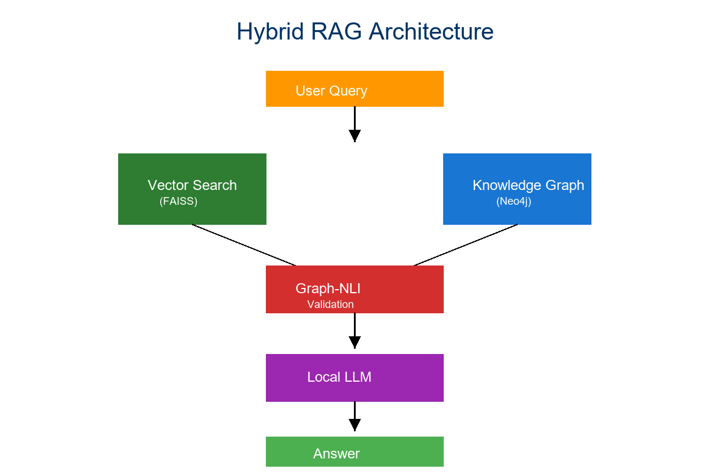

# 🚀 Nexora - SupplyWise Procurement Intelligence Platform



## 📋 Overview

**SupplyWise** is an AI-powered procurement intelligence platform that combines Retrieval-Augmented Generation (RAG), Machine Learning risk scoring, and Knowledge Graphs to help organizations make smarter supplier decisions.

Built on the Nexora framework, SupplyWise solves a critical problem: **80% of procurement executives lack visibility into supplier risks** due to scattered data across spreadsheets and systems.

### 🎯 Key Features

- 🤖 **AI-Powered Q&A** - Natural language queries about suppliers and procurement
- 📊 **Risk Scoring** - ML-based supplier risk assessment (Low/Medium/High)
- 📦 **Product Catalog** - 15 products with images, pricing, and supplier mapping
- ⚖️ **Supplier Comparison** - Compare 2-3 suppliers with AI recommendations
- 🔍 **Semantic Search** - Find suppliers by describing what you need
- 📈 **Analytics Dashboard** - KPIs, charts, and performance metrics
- 📥 **Excel Export** - Color-coded reports for presentations
- 🌐 **Knowledge Graph** - Neo4j-powered supplier relationships (optional)

---

## 🏗️ Architecture

```
┌─────────────────────────────────────────────────────────┐
│                    Web Interface                        │
│         (FastAPI + HTML/CSS/JS + Chart.js)             │
└───────────────────┬─────────────────────────────────────┘
                    │
┌───────────────────▼─────────────────────────────────────┐
│                  Backend Services                       │
├─────────────────────────────────────────────────────────┤
│  • RAG Pipeline (LangChain + Ollama)                   │
│  • Risk Scoring (XGBoost ML Model)                     │
│  • Supplier Analytics                                   │
│  • Comparison Engine                                    │
│  • Excel Handler                                        │
└───────────────────┬─────────────────────────────────────┘
                    │
┌───────────────────▼─────────────────────────────────────┐
│                 Data Layer                              │
├─────────────────────────────────────────────────────────┤
│  • FAISS Vector Store (Embeddings)                     │
│  • Neo4j Knowledge Graph (Optional)                    │
│  • CSV Data (30+ real suppliers from OpenStreetMap)   │
│  • SQLite (Sessions, Audit Logs)                       │
└─────────────────────────────────────────────────────────┘
```

---

## 🚀 Quick Start

### Prerequisites

- Python 3.12 or 3.13
- Ollama with llama3 model
- Neo4j (optional, runs without it)
- 8GB RAM minimum

### Installation

1. **Clone the repository**
```bash
git clone https://github.com/vikaskakarla/Nexora.git
cd Nexora
```

2. **Create virtual environment**
```bash
python -m venv .venv
.venv\Scripts\activate  # Windows
# source .venv/bin/activate  # Linux/Mac
```

3. **Install dependencies**
```bash
pip install -r requirements.txt
```

4. **Set up environment variables**
```bash
# Create .env file
copy .env.example .env  # Windows
# cp .env.example .env  # Linux/Mac

# Edit .env with your settings (Neo4j optional)
```

5. **Download Ollama model**
```bash
ollama pull llama3
```

6. **Populate supplier data**
```bash
python backend/populate_db.py
```

7. **Run the application**
```bash
python -m uvicorn app.app:app --host 127.0.0.1 --port 8000 --reload
```

8. **Open in browser**
```
http://127.0.0.1:8000/supplywise
```

---

## 📊 Features Walkthrough

### 1. Dashboard
- **4 KPIs**: Total suppliers, orders, lead time, on-time rate
- **3 Charts**: Risk distribution, feature importance, category performance
- Real-time analytics

### 2. Suppliers & Risk
- View all 30+ suppliers with real data
- **5 Filters**: Name search, category, risk level, location, min on-time %
- Expandable risk reasons
- Click-to-call phone numbers

### 3. Products Catalog (NEW!)
- 15 products across 6 categories
- Product images, pricing, descriptions
- Filter by category or search
- See common suppliers per product

### 4. Find Suppliers
- Semantic search with natural language
- Example: "reliable cold chain logistics with fast delivery"
- Match scores and full supplier details

### 5. Compare (ENHANCED!)
- Compare 2-3 suppliers side-by-side
- AI-powered recommendations
- Winner badges on best metrics
- Win count analysis

### 6. Excel Tools (NEW!)
- Download color-coded Excel reports (🟢🟡🔴)
- Get blank templates for import
- Summary statistics included

### 7. Ask AI
- Natural language Q&A about suppliers
- RAG-powered accurate answers
- Source citations

---

## 🎨 Screenshots

### Dashboard


### Products Catalog
Browse 15 products with images, prices, and supplier information.

### Supplier Comparison
Compare multiple suppliers with AI recommendations and winner badges.

---

## 🛠️ Technology Stack

### Backend
- **FastAPI** - Web framework
- **LangChain** - RAG pipeline orchestration
- **Ollama** - Local LLM inference (llama3)
- **XGBoost** - ML risk scoring
- **FAISS** - Vector similarity search
- **Neo4j** - Knowledge graph (optional)
- **Pandas** - Data processing

### Frontend
- **HTML/CSS/JS** - Modern dark theme
- **Chart.js** - Interactive visualizations
- **Fetch API** - Async data loading

### Data Sources
- **OpenStreetMap** - Real supplier identities (30+ businesses)
- **Synthetic Data** - Order history and performance metrics
- **Unsplash** - Product images

---

## 📁 Project Structure

```
Nexora/
├── app/
│   ├── app.py                      # FastAPI application
│   └── templates/
│       ├── index.html              # Nexora home
│       ├── supplywise.html         # SupplyWise UI
│       └── analytics.html          # Analytics dashboard
├── backend/
│   ├── main_engine.py              # RAG pipeline
│   ├── supplywise_pipeline.py      # SupplyWise logic
│   ├── comparison_engine.py        # Supplier comparison
│   ├── excel_handler.py            # Excel import/export
│   ├── products_data.py            # Product catalog
│   ├── graph_store.py              # Neo4j integration
│   ├── vector_store.py             # FAISS vector store
│   └── ...
├── data/
│   ├── supplywise/
│   │   ├── suppliers.csv           # Supplier data
│   │   ├── orders.csv              # Order history
│   │   └── docs/                   # Policy documents
│   └── isro_docs/                  # Nexora aerospace docs
├── logs/                           # Analytics and audit logs
├── .env                            # Environment variables (not in repo)
├── requirements.txt                # Python dependencies
└── README.md                       # This file
```

---

## 📚 Documentation

- **QUICK_START_UI.md** - 5-minute UI guide
- **WEB_UI_FEATURES.md** - Complete feature documentation
- **UI_TESTING_GUIDE.md** - Testing checklist
- **NEW_FEATURES_GUIDE.md** - API documentation
- **PROJECT_ENHANCEMENT_PLAN.md** - Future roadmap
- **START_PROJECT.md** - Detailed setup guide

---

## 🔐 Security & Privacy

### What's Tracked
- Query logs (anonymized)
- Performance metrics
- Risk assessments

### What's NOT Tracked
- No user PII
- No external API calls
- All data stays local

### Best Practices
- `.env` file excluded from git
- Neo4j credentials protected
- Audit logs for compliance
- RBAC support ready

---

## 🧪 Testing

### Run API Tests
```bash
# Test all endpoints
python -c "import requests; r=requests.get('http://127.0.0.1:8000/supplywise/dashboard'); print(r.json())"
```

### Run UI Tests
See `UI_TESTING_GUIDE.md` for complete checklist

### Test Excel Export
```bash
curl http://127.0.0.1:8000/supplywise/export -o test_export.xlsx
```

---

## 🚦 Roadmap

### ✅ Completed (v1.0)
- [x] RAG-powered Q&A
- [x] ML risk scoring
- [x] Product catalog with images
- [x] Multi-supplier comparison with AI
- [x] Excel export (color-coded)
- [x] Advanced filtering (5 filters)
- [x] Modern web UI

### 🔮 Planned (v2.0)
- [ ] Real-time risk monitoring
- [ ] Automated alerts
- [ ] Price trend analysis
- [ ] Supplier favorites
- [ ] PDF export
- [ ] Mobile app
- [ ] Multi-user authentication
- [ ] Cloud deployment
- [ ] API rate limiting
- [ ] Advanced analytics

---

## 🤝 Contributing

Contributions are welcome! Please follow these steps:

1. Fork the repository
2. Create a feature branch (`git checkout -b feature/AmazingFeature`)
3. Commit your changes (`git commit -m 'Add AmazingFeature'`)
4. Push to the branch (`git push origin feature/AmazingFeature`)
5. Open a Pull Request

---

## 📄 License

This project is licensed under the MIT License - see the LICENSE file for details.

---

## 👥 Authors

- **Vikas Kakarla** - Initial work - [vikaskakarla](https://github.com/vikaskakarla)

---

## 🙏 Acknowledgments

- **OpenStreetMap** - Real supplier data (ODbL license)
- **Unsplash** - Product images
- **Ollama** - Local LLM infrastructure
- **LangChain** - RAG framework
- **FastAPI** - Web framework

---

## 📊 Stats

- **30+ Suppliers** with real identities from OpenStreetMap
- **15 Products** across 6 categories
- **450+ Orders** in synthetic dataset
- **7 Tabs** in web interface
- **11 API Endpoints** for data access
- **5 Filter Options** for supplier search

---

## 🐛 Known Issues

### Neo4j Connection Warnings
**Status**: Expected when Neo4j not running  
**Impact**: None - app runs in basic mode  
**Solution**: Optional - install Neo4j for graph features

### Image Loading Delays
**Status**: Normal (loading from Unsplash)  
**Impact**: Brief delay before images appear  
**Solution**: Images use lazy loading

---

## 📞 Support

For questions or issues:
- Open an issue on GitHub
- Check documentation in `/docs` folder
- Review `UI_TESTING_GUIDE.md` for troubleshooting

---

## 🌟 Star History

If you find this project useful, please consider giving it a star! ⭐

---

**Built with ❤️ for smarter procurement decisions**
